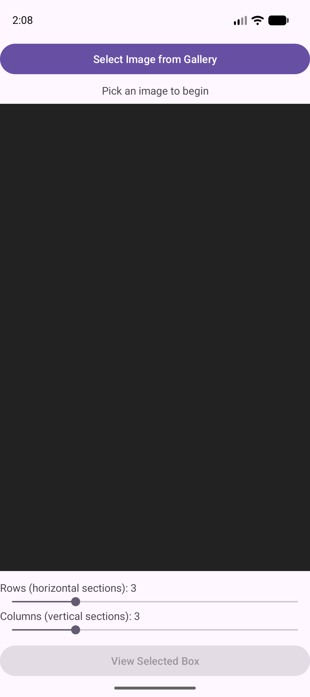
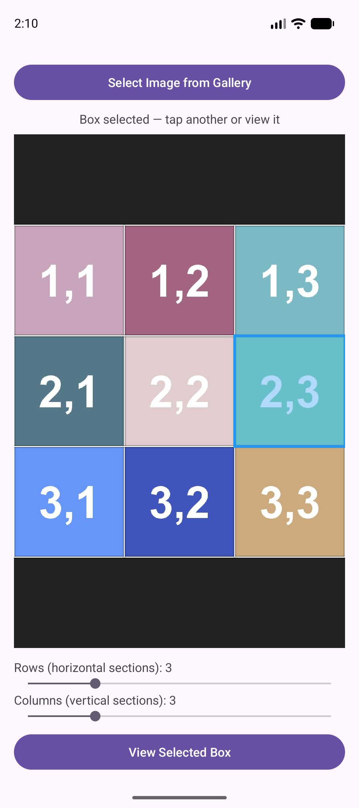
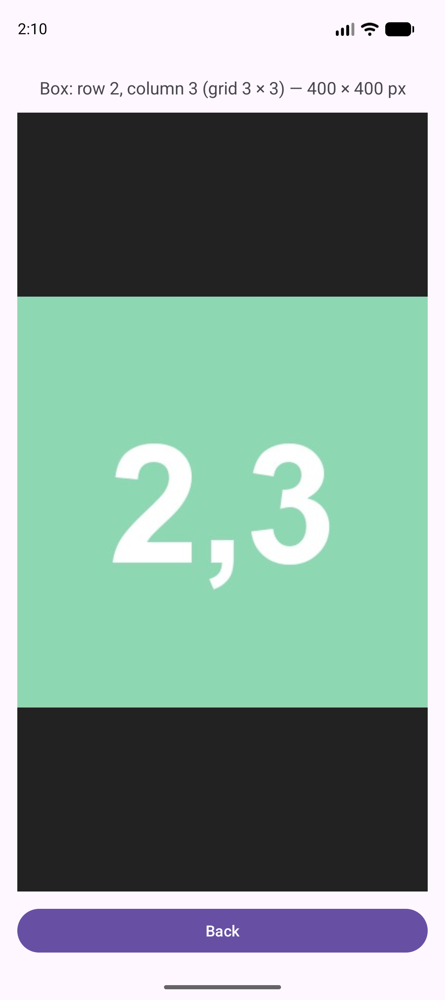
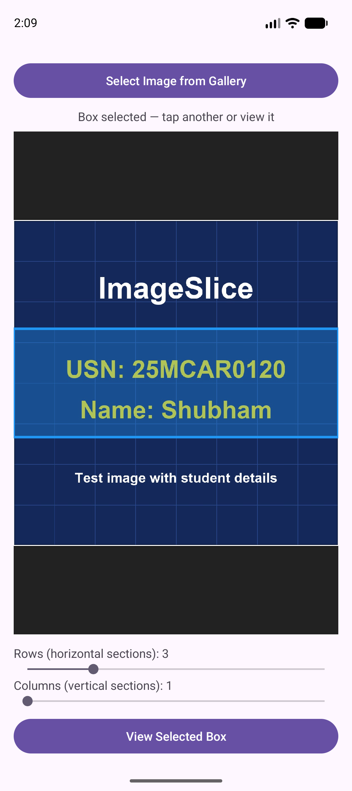
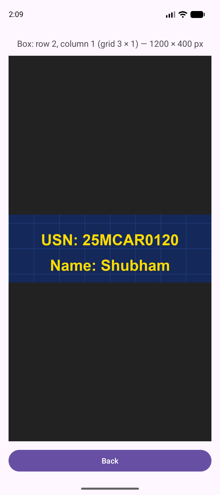
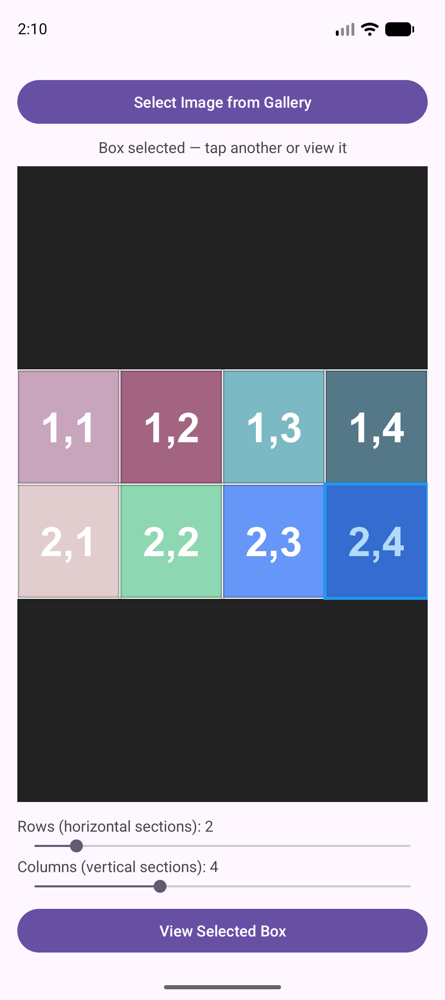
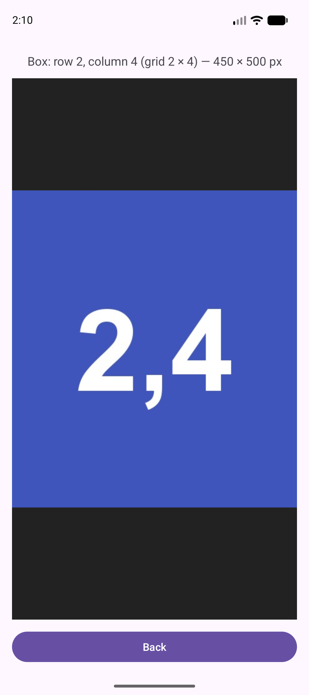

# ImageSlice – Image Grid and Cropping Application

**Student:** Shubham  **USN:** 25MCAR0120

ImageSlice is an Android app (Kotlin) that lets a user pick an image from the
gallery, divide it with adjustable horizontal and vertical grid lines, tap one
box of the grid, and view just that portion in a separate screen.

---

## 1. Aim of the experiment

Build an application that combines **image selection**, a **grid display**,
**image processing (cropping)** and **Intents** to move data between two
Activities.

| Requirement | How ImageSlice implements it |
|---|---|
| Image selection | System photo picker (`ActivityResultContracts.PickVisualMedia`) – no storage permission needed |
| Grid display | Custom `GridImageView` draws the image with grid lines; two `SeekBar`s set rows and columns (1–10) |
| Box selection | Tapping the image maps the touch point to a (row, column) cell, which is highlighted |
| Separate view | `CropActivity` is started with an explicit `Intent`; it crops the box and shows it in an `ImageView` |

## 2. Concepts and technology

- **Image selection / Intents.** The Android photo picker returns a content
  `Uri` for the chosen image. The app does not copy the file. It passes the Uri
  to the second Activity in an explicit `Intent` (`intent.data`) with
  `FLAG_GRANT_READ_URI_PERMISSION`, so the second Activity can read it.
  The grid size and selected cell travel as Intent extras (`rows`, `cols`,
  `row`, `col`).
- **Custom View and Canvas.** `GridImageView` extends `View`. In `onDraw` it
  draws the bitmap fit-centred, then loops over `rows` and `cols` calling
  `canvas.drawLine`. A translucent rectangle and border mark the selected box.
- **SeekBar.** Each bar has `max=9`. The grid size is `progress + 1`, so the
  range is 1–10. Changing a bar redraws the grid and clears the selection,
  because the boxes have changed.
- **Touch mapping.** For a tap at `(x, y)` inside the displayed image
  rectangle: `col = (x - left) / width * cols` and
  `row = (y - top) / height * rows`.
- **Image processing (crop).** `CropActivity` decodes the image again and calls
  `Bitmap.createBitmap(source, left, top, width, height)`. Boundaries are
  computed as `col * W / cols` and `(col + 1) * W / cols` using integer
  arithmetic, so neighbouring boxes tile exactly with no gaps or overlaps.
- **Decoding.** `ImageLoader` downsamples large images to at most 2048 px on
  the long side (to avoid out-of-memory errors) and applies EXIF rotation.
  It uses `ImageDecoder` on API 28+ and `BitmapFactory` plus `ExifInterface` on
  older versions.

## 3. Demonstration scenario

A user has a photo and wants to look closely at one part of it:

1. Open ImageSlice and tap **Select Image from Gallery**.
2. Choose a photo.
3. Drag the **Rows** and **Columns** sliders until the grid has the wanted
   number of sections.
4. Tap a box. It turns blue.
5. Tap **View Selected Box**. A second screen shows only that part of the
   image, with its position (row, column) and size in pixels.
6. Press **Back** to return and choose another box.

For the demo, three synthetic test images were generated. Each tile of the
first two is labelled `row,col`, so a correct crop can be checked by eye. The
third carries the student's USN and name.

## 4. Project structure

```
ImageSlice/
├── README.md                      this file
├── build.gradle.kts               root Gradle build file
├── settings.gradle.kts            module list
├── gradle/libs.versions.toml      dependency / plugin versions
├── docs/
│   ├── screenshots/               output and test-case screenshots
│   └── test_images/               images used in the test cases
└── app/
    ├── build.gradle.kts           app module config (minSdk 24, targetSdk 37)
    └── src/main/
        ├── AndroidManifest.xml    declares MainActivity (launcher) and CropActivity
        ├── java/com/example/imageslice/
        │   ├── MainActivity.kt    picker, SeekBars, selection, launches the Intent
        │   ├── GridImageView.kt   custom View: draws image + grid, handles taps
        │   ├── CropActivity.kt    receives the Intent, crops and shows the box
        │   └── ImageLoader.kt     decodes a Uri into a Bitmap (downsample + EXIF)
        └── res/
            ├── layout/activity_main.xml   picker button, grid view, 2 SeekBars
            ├── layout/activity_crop.xml   info text, ImageView, Back button
            └── values/strings.xml         all user-visible text
```

## 5. How to build and run

1. Open the project in Android Studio.
2. Let Gradle sync, then choose an emulator (API 24+) or a phone.
3. Press **Run**. Or from a terminal: `gradlew.bat installDebug`.

## 6. Output

Home screen on launch, before an image is chosen:



Image loaded with a 3 × 3 grid and box (2,3) selected, then the separate
screen showing that box:

| Grid and selection | Cropped result |
|---|---|
|  |  |

## 7. Test cases

All tests were run on the Android Studio emulator (Pixel 9 AVD, API 37).

### Test case 1 – USN and name image, 3 rows × 1 column (shows USN and name)

- **Input:** `docs/test_images/test_C_usn_name.jpg` (1200 × 1200). Rows = 3,
  Columns = 1. Tap the middle band, then **View Selected Box**.
- **Expected:** the second screen shows the middle horizontal band with the
  USN and name, 1200 × 400 px, labelled row 2, column 1.
- **Actual:** the band containing **USN: 25MCAR0120** and **Name: Shubham** is
  shown, "Box: row 2, column 1 (grid 3 × 1) — 1200 × 400 px". **Pass.**

| Grid and selection | Cropped result |
|---|---|
|  |  |

### Test case 2 – Default 3 × 3 grid, box (2,3)

- **Input:** `docs/test_images/test_A_square.jpg` (1200 × 1200, tiles labelled
  `row,col`). Rows = 3, Columns = 3. Tap the right-hand box of the middle row.
- **Expected:** a 400 × 400 px crop of the tile labelled "2,3".
- **Actual:** the crop shows tile "2,3", "Box: row 2, column 3 (grid 3 × 3) —
  400 × 400 px". **Pass.**

| Grid and selection | Cropped result |
|---|---|
|  |  |

### Test case 3 – Landscape image, adjusted to 2 rows × 4 columns, box (2,4)

- **Input:** `docs/test_images/test_B_landscape.jpg` (1800 × 1000). Rows
  slider moved to 2, Columns slider moved to 4. Tap the bottom-right box.
- **Expected:** the grid redraws as 2 × 4 and the crop is 450 × 500 px, showing
  the tile labelled "2,4".
- **Actual:** the labels update to "Rows: 2" and "Columns: 4", and the crop shows
  tile "2,4", "Box: row 2, column 4 (grid 2 × 4) — 450 × 500 px". **Pass.**

| Grid and selection | Cropped result |
|---|---|
|  |  |

## 8. Notes and limitations

- Selecting a box is disabled until the user taps one; **View Selected Box**
  stays greyed out until then.
- Very large images are downsampled to 2048 px on the long side, so the
  cropped box is also at that reduced resolution.
- Tested on one emulator only. Not tested on a physical device or on API
  levels below 37.
